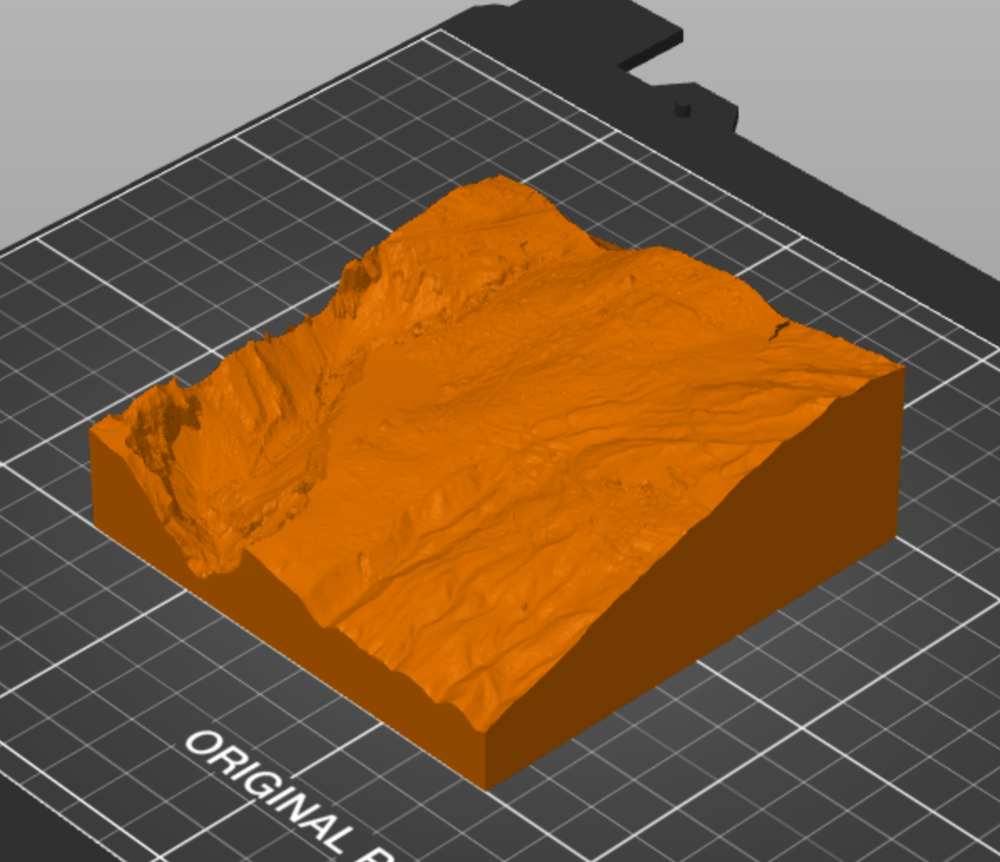
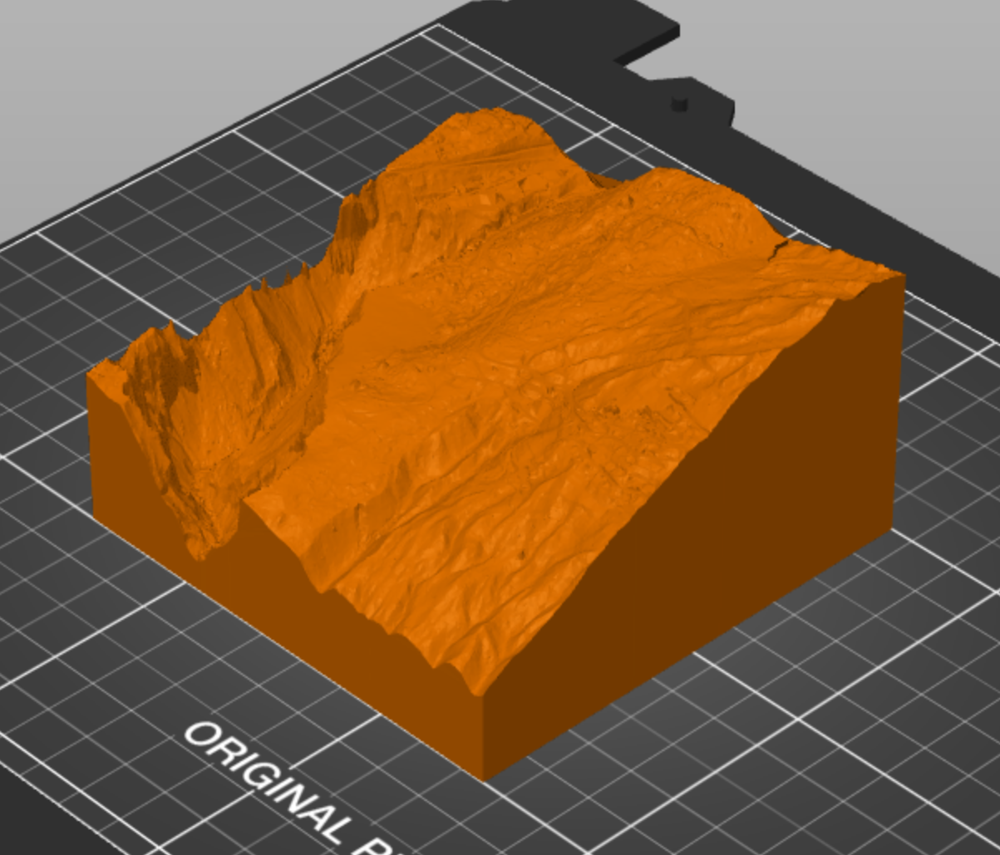
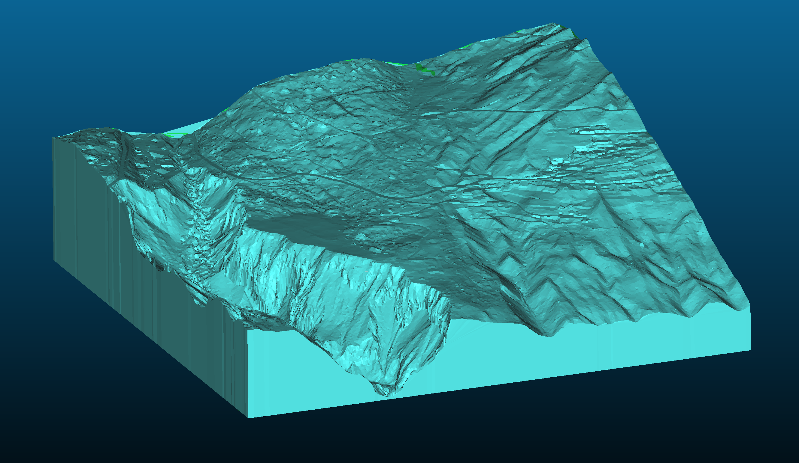
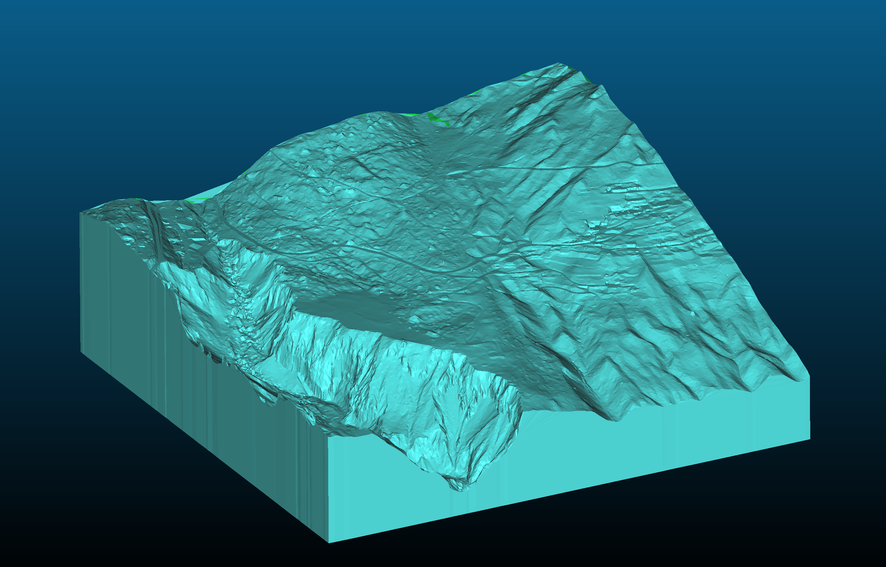
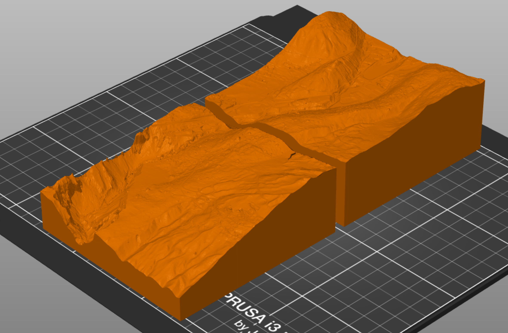
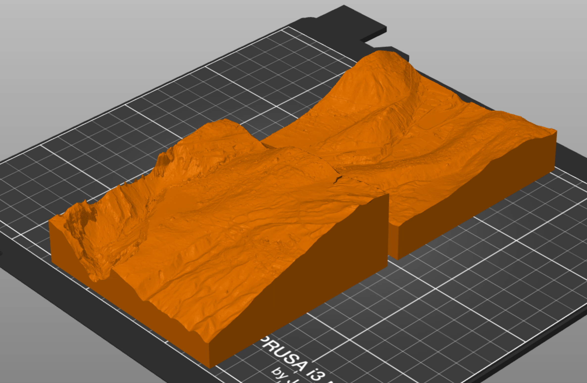

# las2stl

LAS2STL is a Python script which allows you to automatically convert a Lidar
point cloud to a 3D printable mesh. It tries to reconstruct the point cloud
surface as accurately as possible, but still allows you to specify different
parameters to control the output of the script.

## Requirements

Python 3.10 or newer is required. To install the python libraries, run the
following:

* Install virtualenv: `python -m pip install --user virtualenv`
* Create virtual env: `virtualenv venv`
* Activate virtual env: `source ./venv/bin/activate` (on Windows: `venv\Scripts\activate`)
* Install requirements: `pip install -r requirements.txt`

## Usage

* Place your lidar .las files in the `las` folder.
* Open a command prompt.
* Run `python las2stl.py`.
* The finished mesh is placed in the `stl` folder.

## Configuration

There are some options at the top of the Python script that allow you to tweak
the mesh generation:

### GROUND_ONLY

Must be True or False. Decides whether all points should be used, or only those
marked as a ground return. If you want to include buildings and trees, set this
option to False. If you only want the terrain, set it to True.

### SAMPLE_RATE

Must be between 0.0 and 1.0. Most lidar point clouds are too large to
generate a mesh from. This setting allows you to sample the point cloud. A
value of 0.3 means that 30% of the points are kept, the rest are discarded. A
higher value means more resolution, but also more processing time and memory.
For a 1x1km swissSURFACE3D tile (11.5 million points), 0.05 takes a few seconds
and less than 1GB of memory, while 1.0 takes over a minute and 12GB.

### SCALEXY / SCALEZ
Must be between 0.0 and Infinity. Defines the scaling factor
between the Lidar point cloud and the final mesh. SCALEXY controls the
horizontal scale, SCALEZ controls the height. This allows you to exaggerate the
height of the features. A value of 1.0 means that a cloud of size 1000x1000m is
converted to a mesh of 1000x1000mm. A factor of 0.15 would create a mesh of
size 150x150mm. Note that the scale factor is not mathematically correct, since
many slicers auto-convert meters to millimeters.

| SCALEXY = SCALEZ = 0.1 | SCALEXY = 0.1, SCALEZ = 0.15 |
|---|---|
|  |  |
| Length, width and height are equally scaled | Height is 50% exaggerated respective to length and width |

### BASE_THICKNESS

Must be greater than 0.0. Controls the minimal thickness of the base the model
stands on, which is added below the lowest point (or below BASE_HEIGHT if
COMMON_BASE is True). The thickness also depends on SCALEZ: the base is
`BASE_THICKNESS × (1 - SCALEZ) × SCALEZ` millimeters thick. With SCALEZ = 0.1, a
value of 50 gives a 4.5mm base and a value of 5 gives a 0.45mm base.

| BASE_THICKNESS=5 | BASE_THICKNESS=50 |
|---|---|
|  |  |
| A thin base is added below the lowest point | A base ten times as thick is added below the lowest point |

### BASE_HEIGHT

Can be any number. The altitude in meters above sea level where the final mesh should begin. This should be less than the lowest point in your point cloud. Otherwise the printed spacer height is negative, and with COMMON_BASE = True the base gets thinner or the terrain cuts through it.

### COMMON_BASE

True or False. Whether all meshes should begin at the same altitude. Setting it to True makes assembly easier, but might produce lots of unnecessary volume if the tiles include very different altitudes. Setting it to False requires the tiles to be placed on spacers.

If the setting is False, the height of the spacer in Millimeters is printed at the end of the script.

| COMMON_BASE = True | COMMON_BASE = False |
|---|---|
|  |  |
| - | Prints "This tile needs a 0.5mm spacer" and "This tile needs a 20.2mm spacer" |
